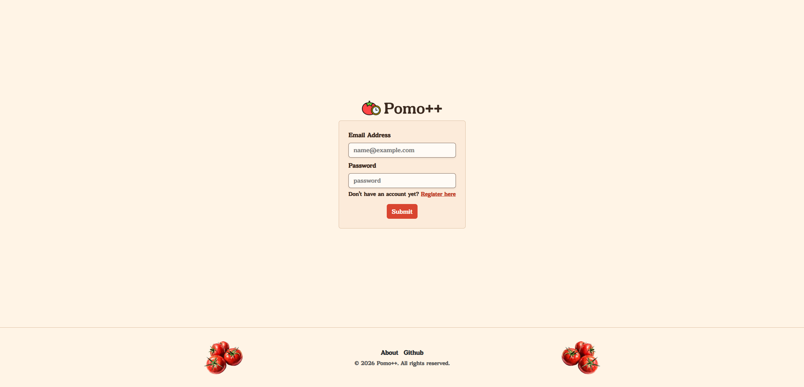
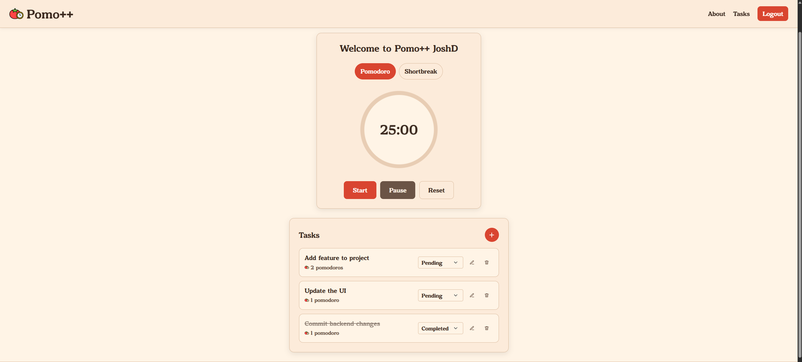
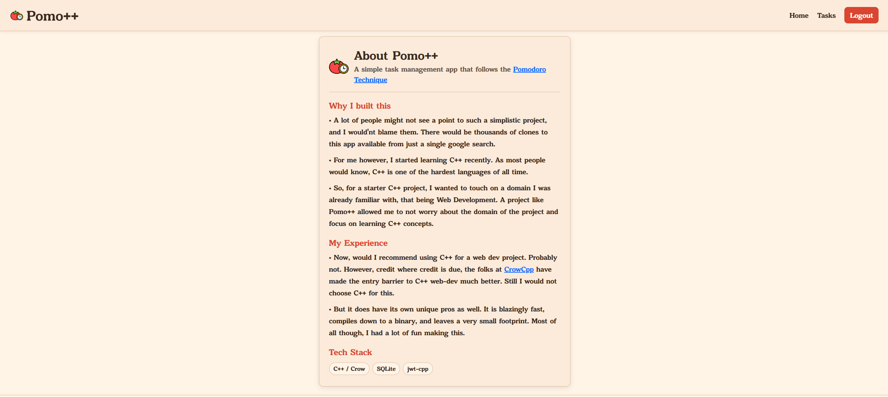

# PomoPlusPlus

**A Pomodoro-powered productivity app built with C++20.**

PomoPlusPlus is a productivity application designed to bring focused work sessions and task management together. Built using modern C++, the Crow web framework, and SQLite, this project explores building and deploying a complete web application with a compiled backend.

## Login


### Pomodoro


### About



## Features

- **Pomodoro productivity** — Organize work into focused sessions and breaks.
- **Task management** — Create and manage tasks through a dedicated backend service.
- **User authentication** — Registration and login with JWT-based authentication.
- **Database integration** — Store application data using SQLite.
- **Web interface** — Serve HTML templates and static assets directly through Crow.
- **Containerized deployment** — Package and run the application using Podman and OCI container images.

## Tech Stack

| Technology | Purpose |
|---|---|
| C++20 | Core application logic |
| Crow | HTTP server and routing |
| SQLite & SQLiteCpp | Relational data storage |
| jwt-cpp | JWT authentication |
| Asio | Networking |
| CMake | Build configuration |
| Conan 2 | Dependency management |
| Podman | Containerization and deployment |

## Skills & Concepts Learned

Building PomoPlusPlus gave me hands-on experience with several areas of software development beyond writing application code.

- **Modern C++ development** — Working with C++20, third-party libraries, and a compiled backend application.
- **Backend architecture** — Separating authentication, task services, DTOs, and utility code into distinct responsibilities.
- **HTTP and API development** — Handling routes, requests, responses, and server-side application workflows using Crow.
- **Authentication and security** — Implementing JWT-based authentication and learning how to handle user credentials and protected operations.
- **Database management** — Integrating SQLite, managing database connections, and handling schema initialization and persistence.
- **Dependency management** — Using Conan 2 to manage external C++ libraries and integrating them with CMake.
- **Build systems and debugging** — Configuring native dependencies, resolving compiler and linker issues, and troubleshooting runtime failures.
- **Containerization** — Creating multi-stage container builds, managing runtime dependencies, and deploying container images.
- **Deployment and operations** — Working with GHCR, remote container hosting, environment configuration, logs, and production-style debugging.

## Architecture

```text
Browser
   |
   v
Crow HTTP Server
   |
   +---- Authentication Services
   |
   +---- Task Services
   |
   +---- Templates & Static Assets
   |
   v
SQLite Database
```

The application uses a service-oriented structure to keep request handling, business logic, data-transfer objects, and database operations organized.

## What I'd Improve Next

- Add automated tests for authentication and task workflows.
- Introduce database migrations and stronger schema management.
- Improve production database persistence and deployment reliability.
- Add productivity statistics and session history.
- Set up continuous integration for automated builds and image publishing.

## Author

**Josh Dagla**

Computer Science student interested in modern C++, backend engineering, and full-stack development.

- GitHub: [@joshdagla](https://github.com/joshdagla)

---

*PomoPlusPlus — Focus on the task. Make every session count.*
